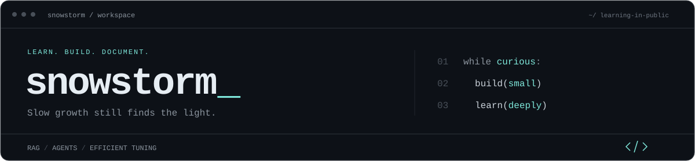

  

  <a href="#selected-projects">Selected projects</a> &nbsp;·&nbsp;
  <a href="https://snowstorm-121.github.io/">Notes &amp; writing</a> &nbsp;·&nbsp;
  <a href="https://github.com/snowstorm-121?tab=repositories">All repositories</a>

### Hi, I'm snowstorm ❄️

AI & Automation at **HUST**, based in **Wuhan, China**.

I build and study local AI applications, from evidence-grounded retrieval to tool-using agents and efficient fine-tuning.

- **Current focus:** RAG · Agent workflows · Tool calling
- **How I work:** small experiments, traceable results, documented trade-offs
- **Outside the code:** [learning notes and life](https://snowstorm-121.github.io/)

 

## Selected projects

<table>
  <tr>
    <td width="50%" valign="top">
      <h3>01 &nbsp; <a href="https://github.com/snowstorm-121/ScholarLens">ScholarLens · 研知</a></h3>
      
<strong>Local paper Q&amp;A with inspectable evidence.</strong>

      
A Kotaemon-based workspace for single-paper retrieval, cited answers, and reproducible evaluation with local models.

      
<code>RAG</code> <code>Ollama</code> <code>QASPER</code>

      
<a href="https://github.com/snowstorm-121/ScholarLens#演示">Demo</a> &nbsp;·&nbsp; <a href="https://github.com/snowstorm-121/ScholarLens/blob/main/reports/test.md">Evaluation</a>

    </td>
    <td width="50%" valign="top">
      <h3>02 &nbsp; <a href="https://github.com/snowstorm-121/RetailFlow">RetailFlow</a></h3>
      
<strong>Tool-using agents with explicit user confirmation.</strong>

      
A local retail simulation prototype with human-confirmed order changes, persistent sessions, and transactional execution receipts.

      
<code>LangGraph</code> <code>Ollama</code> <code>SQLite</code>

      
<a href="https://github.com/snowstorm-121/RetailFlow/blob/main/docs/demos.md">Demos</a> &nbsp;·&nbsp; <a href="https://github.com/snowstorm-121/RetailFlow/blob/main/docs/architecture.md">Architecture</a>

    </td>
  </tr>
  <tr>
    <td width="50%" valign="top">
      <h3>03 &nbsp; <a href="https://github.com/snowstorm-121/ToolTune">ToolTune</a></h3>
      
<strong>Auditable LoRA experiments for tool calling.</strong>

      
4-bit Qwen3 experiments on Apple Silicon, with strict data splits, validation-selected adapters, and a frozen diagnostic test.

      
<code>MLX</code> <code>LoRA</code> <code>Qwen3</code>

      
<a href="https://github.com/snowstorm-121/ToolTune/blob/main/reports/T4-test.md">Results &amp; limitations</a> &nbsp;·&nbsp; <a href="https://github.com/snowstorm-121/ToolTune/blob/main/UPSTREAM.md">Reproducibility</a>

    </td>
    <td width="50%" valign="top">
      <h3>04 &nbsp; <a href="https://github.com/snowstorm-121/pytorch_learning">PyTorch Learning</a></h3>
      
<strong>Understanding the foundations, one experiment at a time.</strong>

      
Tensor and autograd fundamentals, CNNs, Transformers, and controlled BERT full fine-tuning versus LoRA experiments.

      
<code>PyTorch</code> <code>Transformers</code> <code>PEFT</code>

      
<a href="https://github.com/snowstorm-121/pytorch_learning#目录">Learning path</a> &nbsp;·&nbsp; <a href="https://github.com/snowstorm-121/pytorch_learning/tree/main/Stage_5_Projects/bert-full-vs-lora">BERT / LoRA study</a>

    </td>
  </tr>
</table>

## A little progress, every day

<picture>
  <source media="(prefers-color-scheme: dark)" srcset="https://raw.githubusercontent.com/snowstorm-121/snowstorm-121/main/profile/github-snake-dark.svg" />
  <source media="(prefers-color-scheme: light)" srcset="https://raw.githubusercontent.com/snowstorm-121/snowstorm-121/main/profile/github-snake.svg" />
  
</picture>

Learning in public · Building with care · Keeping the evidence

