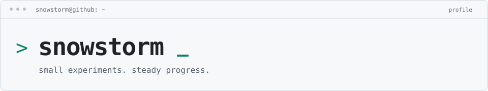

<picture>
  <source media="(prefers-color-scheme: dark)" srcset="./assets/header.svg" />
  <source media="(prefers-color-scheme: light)" srcset="./assets/header-light.svg" />
  
</picture>

**AI & Automation · HUST** 
Exploring RAG, agents, and efficient fine-tuning through local, reproducible experiments.

[Notes & writing](https://snowstorm-121.github.io/) · [All repositories](https://github.com/snowstorm-121?tab=repositories)

### `~/projects`

| Project | Focus |
| :--- | :--- |
| **[ScholarLens · 研知](https://github.com/snowstorm-121/ScholarLens)** | Local paper Q&A with evidence and citations, built on Kotaemon. |
| **[RetailFlow](https://github.com/snowstorm-121/RetailFlow)** | A retail agent prototype with user-confirmed actions and persistent sessions. |
| **[ToolTune](https://github.com/snowstorm-121/ToolTune)** | Qwen3 tool-calling experiments with MLX and LoRA on Apple Silicon. |
| **[PyTorch Learning](https://github.com/snowstorm-121/pytorch_learning)** | Hands-on studies from autograd to Transformers and BERT fine-tuning. |

### `~/contributions`

<picture>
  <source media="(prefers-color-scheme: dark)" srcset="https://raw.githubusercontent.com/snowstorm-121/snowstorm-121/main/profile/github-snake-dark.svg" />
  <source media="(prefers-color-scheme: light)" srcset="https://raw.githubusercontent.com/snowstorm-121/snowstorm-121/main/profile/github-snake.svg" />
  
</picture>
